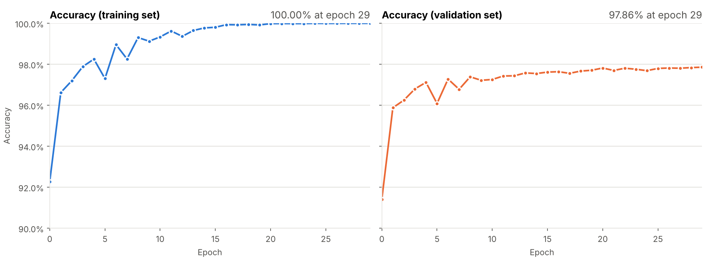

# Handwritten Digit Recognizer

A neural network implementation built from scratch using NumPy to recognize handwritten digits trained on the MNIST dataset. This project demonstrates core deep learning concepts including forward propagation, backpropagation, activation functions, and optimization techniques.

<p align="center">
  
</p>

## Table of Contents

[Overview](#overview)<br>
[Architecture](#architecture)<br>
[Technologies & Dependencies](#technologies--dependencies)<br>
[Project Structure](#project-structure)<br>
[Core Components](#core-components)<br>
[How It Works](#how-it-works)<br>
[App System](#app-system)<br>
[Usage](#usage)<br>
[Benchmark](#benchmark)<br>
[Learning Outcomes](#learning-outcomes)<br>
[Dataset](#dataset)<br>
[References](#references)<br>

## Overview

**Key Performance Metrics:**

- Accuracy: 97.97% on the test set, measured once on the model chosen by validation accuracy (see [Benchmark](#benchmark))
- Training: mini-batch SGD, 30 epochs, about 1 minute on a CPU
- Dataset: MNIST, split into 50,000 training, 10,000 validation and 10,000 test images
- Input Size: 784 pixels (28×28 images)
- Output Classes: 10 (digits 0-9)

## Architecture

The neural network consists of:

- **Input Layer**: 784 neurons (flattened 28×28 pixel images)
- **Hidden Layer 1**: 128 neurons with ReLU activation
- **Hidden Layer 2**: 64 neurons with ReLU activation
- **Output Layer**: 10 neurons with Softmax activation (one per digit)

## Technologies & Dependencies

- **Python 3.10+**
- **NumPy**: the whole network, including reading the MNIST IDX files (a 16-line parser, no extra dependency)
- **Pillow**: image processing for UI input
- **Matplotlib**: accuracy plots during training

### Installation

1. Clone the repository:

```bash
git clone https://github.com/phantomvoyager4/HandwrittenDigitRecognizer.git
cd HandwrittenDigitRecognizer
```

2. Create a virtual environment (optional but recommended):

```bash
python -m venv venv
source venv/bin/activate  # On Windows: venv\Scripts\activate
```

3. Install dependencies:

```bash
pip install -r requirements.txt
```

4. Verify the structure:
   - Ensure `dataset/` contains MNIST binary files
   - Ensure `models_data_storage/` contains pretrained models
   - Ensure `source/` contains the Python scripts

## Project Structure

```
HandwrittenDigitRecognizer/
├── source/                          # Main source code
│   ├── model.py                     # Neural network implementation
│   ├── train.py                     # Training script (mini-batch or full-batch, validation split)
│   ├── plot.py                      # Training and validation accuracy plots
│   ├── raport.py                    # Training report (bias, variance, test result, per-digit metrics)
│   └── App.py                       # Interactive GUI application
├── dataset/                         # MNIST dataset files (binary IDX format)
│   ├── train-images.idx3-ubyte      # 60,000 training images
│   ├── train-labels.idx1-ubyte      # Training labels
│   ├── t10k-images.idx3-ubyte       # 10,000 test images
│   └── t10k-labels.idx1-ubyte       # Test labels
├── models_data_storage/             # Pretrained model weights
│   ├── model_1/                     # Current model: mini-batch SGD
│   │   ├── model_1_97.97_0.1.npz    # Weights, 97.97% test accuracy
│   │   ├── model_1_accuracy.png     # Training and validation accuracy plots
│   │   ├── model_1_history.csv      # Accuracy per epoch
│   │   └── model_1_raport.txt       # Training report
│   └── model_2/                     # Comparison: full-batch gradient descent (same files)
├── user_input_storage/              # Storage for saved user drawings
├── requirements.txt                 # Python dependencies
├── README.md                        # This file
└── LICENSE                          # Project license
```

## Core Components

### model.py - Neural Network Implementation

#### `data_handling(pathimages, pathlabels)`

Loads MNIST data from the IDX binary format with a small NumPy parser (`read_idx`) and normalizes pixel values to [0, 1].

#### `train_validation_split(images, labels, validation_size, seed)`

Cuts a validation set out of the 60,000 training images (10,000 by default). Model selection uses only this set, so the test set stays unseen until the end.

#### `Layer` Class

Implements a fully connected neural network layer with:

- **Forward Propagation**: `forward(input)` - Computes weighted sum and bias
- **Backward Propagation**: `backward(dvalues)` - Calculates gradients for weights, biases, and inputs
- Weights use He initialization (`randn * sqrt(2 / n_inputs)`), suited to ReLU

#### `Activation_RELU` Class

Implements ReLU (Rectified Linear Unit) activation function:

- **Forward**: `max(0, x)` - Non-linear activation
- **Backward**: Gradient passing for backpropagation

#### `Softmax` Class

Converts raw network output to probability distribution:

- Numerically stable implementation with max subtraction
- Output sums to 1 across all classes

#### `Loss` Class

Computes categorical cross-entropy loss:

- Formula: $-\ln(y_{pred})$ for the correct class
- Clipping predictions to prevent log(0) errors

#### `Backpropagation` Class

Combines Softmax and Loss for efficient gradient calculation:

- Integrates forward pass through activation and loss
- Computes backward gradients for optimization

#### `Optimizer` Class

Implements the plain gradient descent update. Whether training is stochastic (mini-batch SGD) or full-batch depends only on how many images `train.py` passes per step:

- Adjusts weights and biases using learning rate
- Simple parameter update rule: $\theta = \theta - \alpha \cdot \nabla\theta$

### train.py - Training Script

Trains the network with mini-batch SGD by default: the training images are shuffled every epoch and split into batches of 64. After each epoch it measures accuracy on the training and validation sets and keeps the weights from the epoch with the best validation accuracy. The test set is evaluated once, on those weights, after training ends. Every setting is a command-line option (see [Training a New Model](#training-a-new-model)).

## How It Works

**Forward Propagation**: Input (784 features) → Layer 1 (128 neurons, ReLU) → Layer 2 (64 neurons, ReLU) → Output (10 classes, Softmax) → Loss

**Backward Propagation**: Computes gradients through Softmax/Loss, propagates back through both hidden layers, and updates all weights and biases after every mini-batch.

### Key Mathematics

**ReLU**: $f(x) = \max(0, x)$ <br> **Softmax**: $\sigma(z_i) = \frac{e^{z_i}}{\sum_j e^{z_j}}$ <br> **Cross-Entropy Loss**: $L = -\sum_i y_i \ln(\hat{y}_i)$

## App System

### App.py - Interactive GUI Application

An interactive Tkinter-based GUI that loads a trained model and allows real-time digit prediction from user drawings.

**Key Features:**

- **Model Loading**: `transfer_network()` loads pretrained weights from saved `.npz` files
- **Network Pipeline**: Implements the full neural network using loaded layers and selected activation
- **Drawing Canvas**: 300×300 pixel drawing area with black ink on white background
- **Image Processing**: Converts hand-drawn images to normalized 28×28 pixel format matching MNIST specifications
  - Grayscales and inverts the image
  - Centers the digit using bounding box
  - Scales to 20×20 and pads to 28×28
  - Normalizes pixel values to [0, 1]
- **Real-time Prediction**: Processes drawn image through network and displays predicted digit
- **Controls**: "Predict" button triggers recognition, "Clear" button resets canvas

**Workflow:**

1. App initializes with pretrained model
2. User draws digit on canvas
3. Clicking "Predict" sends image through preprocessing pipeline
4. Network pipeline forwards the normalized image through all layers
5. Output layer produces 10 class probabilities via Softmax
6. `argmax` selects the highest probability digit
7. Result displayed with confidence percentage
8. Optional: Save drawn image with prediction metadata

**Network Pipeline Components:**

```
Input (784) → Layer1 (128) → [ReLU] → Layer2 (64) → [ReLU] → Output (10) → Softmax → Prediction
```

**UI Features:**

- Checkbox for optional image saving
- Real-time prediction display
- Confidence percentage shown with prediction
- Preprocessing: grayscale, invert, center, resize, normalize
- Saves images to `user_input_storage/` with timestamp and confidence

## Usage

### Running the GUI Application

```bash
python source/App.py
```

Launch the interactive digit recognizer:

1. Click "Select model" and load a pretrained model from `models_data_storage/`
2. Draw a digit (0-9) on the white canvas
3. Check "Save image?" if you want to save the drawing (saved to `user_input_storage/`)
4. Click "Predict" to see the AI's prediction with confidence
5. Click "Clear" to reset and draw again

**Example:** Draw a "7" → Prediction: 7 (99.45%)

### Training a New Model

```bash
python source/train.py                                            # mini-batch SGD, the current model
python source/train.py --batch-size 0 --learning-rate 0.5 --epochs 1000   # full-batch gradient descent
```

| Option | Default | Meaning |
|---|---|---|
| `--epochs` | 30 | Passes over the training set |
| `--learning-rate` | 0.1 | Step size of the gradient descent update |
| `--batch-size` | 64 | Images per update; `0` uses the whole training set (full-batch) |
| `--validation-size` | 10000 | Images cut from the training set to choose the best epoch |
| `--seed` | 42 | Fixes weight initialization, the validation split and the batch order, so a run can be reproduced |
| `--no-plot` | off | No live plot window (for example over SSH); the plot is still saved |

Training runs with the following workflow:

1. The training images are shuffled every epoch and processed in mini-batches
2. After each epoch, accuracy is measured on the training and validation sets (shown live in two plots)
3. The weights from the epoch with the best validation accuracy are kept
4. Only then is the test set evaluated, once, on those weights
5. The model is saved to `models_data_storage/model_<number>/` with its accuracy plot, per-epoch history (`.csv`) and a training report (`model_<number>_raport.txt`): configuration and training time, training/validation/test accuracy of the selected model, bias and variance, convergence speed, sudden accuracy drops, and per-digit accuracy (recall), precision and F1 on the test set

**Example Output:**

```
Starting training: Mini-batch SGD (batch size 64), learning rate 0.1, 30 epochs
Training set 50000, validation set 10000, test set 10000 (used once, after training)
Epoch: 0, Loss: 0.358, Accuracy: 0.9227, Validation_Accuracy: 0.9140
Epoch: 3, Loss: 0.091, Accuracy: 0.9789, Validation_Accuracy: 0.9680
Epoch: 6, Loss: 0.053, Accuracy: 0.9896, Validation_Accuracy: 0.9728
...
Best epoch: 29 (validation accuracy 0.9786), test accuracy: 0.9797
```

**Model Saving**: models are saved as NumPy `.npz` files named `model_<number>_<test accuracy>_<learning rate>.npz`, which the app loads directly.

## Benchmark

Both models use the same network, the same seed and the same 50,000 / 10,000 / 10,000 split, and both were trained on the same CPU. The only difference is how many images each weight update sees.

| | Mini-batch SGD (**model_1**, current) | Full-batch gradient descent (model_2) |
|---|---|---|
| Batch size / learning rate | 64 / 0.1 | 50,000 / 0.5 |
| Epochs | 30 | 1000 |
| Training time | **1m 5s** | 30m 52s |
| Training accuracy reached 95% | epoch 1 | epoch 164 |
| Selected epoch (best validation) | 29 | 924 |
| Training / validation accuracy | 100.00% / 97.86% | 99.11% / 97.26% |
| **Test accuracy** (measured once) | **97.97%** | 97.41% |
| Macro precision / recall / F1 (test) | 97.96% / 97.95% / 97.95% | 97.41% / 97.38% / 97.39% |
| Weakest digit (test recall) | 8 (96.92%) | 5 (95.96%) |

Full-batch gradient descent makes one update per epoch, so it needs about 1000 epochs to get close; mini-batch SGD makes 782 updates per epoch and gets further in 30. Training times include measuring training and validation accuracy after every epoch.

<p align="center">
  
</p>

The full-batch run is also less stable: training accuracy collapses and recovers several times in the first 250 epochs (8 falls of 5 percentage points or more; the last one, at epoch 238–248, goes from 96.0% to 84.8%), a sign that a learning rate of 0.5 is close to the largest step full-batch training can take on this network ([plot](models_data_storage/model_2/model_2_accuracy.png)).

**Limitation**: model_1 reaches 100% training accuracy while validation stays near 97.9%, so the network memorizes the training set. The next step is regularization (L2 weight decay or dropout) and data augmentation (small shifts and rotations), which also matter for digits drawn in the app, since they look less like MNIST than the test set does.

Full results, including per-digit metrics, are in [`model_1_raport.txt`](models_data_storage/model_1/model_1_raport.txt) and [`model_2_raport.txt`](models_data_storage/model_2/model_2_raport.txt).

## Learning Outcomes

This project demonstrates:

- **Neural Network Architecture**: Building networks from scratch without frameworks
- **Forward Propagation**: How data flows through layers and activations
- **Backpropagation**: Computing gradients and updating weights
- **Optimization**: Mini-batch SGD compared with full-batch gradient descent on equal terms
- **Evaluation**: Train / validation / test split, model selection on validation only, a single test measurement
- **Activation Functions**: ReLU for hidden layers, Softmax for output
- **Derivative Computation**: Implementing correct backward passes for different activation functions
- **Loss Functions**: Cross-entropy loss for multi-class classification
- **Image Processing**: Preprocessing, normalization, and transformation
- **GUI Development**: Building interactive applications with Tkinter
- **Model Serialization**: Saving and loading trained neural networks
- **End-to-End ML Systems**: Data → Model → Training → Inference

## Dataset

The MNIST dataset contains 70,000 handwritten digit images (28×28 pixels):
- **Training Set**: 60,000 images
- **Test Set**: 10,000 images
- **Format**: Binary IDX format (read with `read_idx` in `model.py`)
- **Split used here**: 50,000 training, 10,000 validation (cut from the training set with a fixed seed), 10,000 test
- **Pixel Values**: 0-255 (normalized to [0, 1] for training)

Source: [MNIST Database by Yann LeCun](http://yann.lecun.com/exdb/mnist/)


## References

- [Neural Networks and Deep Learning](http://neuralnetworksanddeeplearning.com/) - Michael Nielsen
- [ReLU Activation Function](https://en.wikipedia.org/wiki/Rectifier_(neural_networks))
- [Softmax and Cross-Entropy](https://en.wikipedia.org/wiki/Softmax_function)
- [Backpropagation Algorithm](https://en.wikipedia.org/wiki/Backpropagation)
- [MNIST Dataset](http://yann.lecun.com/exdb/mnist/)


**Note**: This project was built to understand and dive into neural network mechanics. For production applications, use established frameworks like PyTorch, TensorFlow, or scikit-learn.
